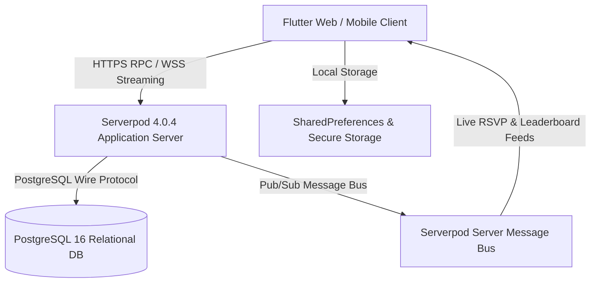

# Campus Pulse — System Architecture & Design Specification

## 1. Executive Architecture Overview

Campus Pulse is an enterprise-grade full-stack campus collaboration platform built with **Flutter** (frontend) and **Serverpod** (backend on Dart), backed by an authoritative **PostgreSQL** database with real-time WebSocket streaming capabilities.

---

## 2. Component Architecture

### 2.1 Backend Layer (`campus_pulse_server`)
- **Protocol Models (`.spy.yaml`)**:
  - `StudentProfile`: Represents authenticated student profile, academic metadata, subject interests, and matchmaking parameters.
  - `CampusEvent`: Event definitions, categorized under Tech, Sports, Cultural, Workshop, and Hackathon.
  - `EventRsvp`: Transactional RSVP records with unique compound index `(eventId, studentId)` to eliminate double-registration at database level.
  - `StudyRequest`: Peer study session invites with deterministic status lifecycles (`pending`, `accepted`, `declined`).
  - `QuizQuestion`: Authoritative question repository with cheat-proof answer masking.
  - `QuizAttempt`: Immutable record of student quiz attempts with time-to-complete tracking.
  - `LeaderboardEntry`: Aggregated rankings computed with deterministic tie-breaking.
  - `ContactMessage`: Persisted support and contact inquiries.
- **Endpoints**:
  - `StudentEndpoint`: Profile management, discoverability, deterministic matchmaking algorithm.
  - `EventEndpoint`: Event publishing, categorized queries, transactional RSVP handling, WebSocket change streams.
  - `StudyRequestEndpoint`: Outgoing and incoming peer matching coordination.
  - `QuizEndpoint`: Server-side authoritative grading, score persistence, answer masking.
  - `LeaderboardEndpoint`: Aggregated ranking calculations and live broadcasts.
  - `SearchEndpoint`: Unified cross-entity search and user inquiries.
  - `SeedEndpoint`: Idempotent development data seeding.

### 2.2 Client SDK (`campus_pulse_client`)
- Generated directly by the Serverpod compiler.
- Contains strongly-typed data models and endpoint clients with full async/await semantics and streaming support.

### 2.3 Frontend Layer (`campus_pulse_flutter`)
- **Design System (`lib/theme/`)**:
  - Strict adherence to Apple Human Interface Guidelines and supplied design tokens.
  - Palette: `#0071E3` (Primary Blue), `#2997FF` (Secondary Blue), `#24568E` (Accent Blue), `#1D1D1F` (Primary Text), `#86868B` (Secondary Text), `#E8E8ED` (Light Neutral), `#FFFFFF` (White).
  - Spacing Scale: `1, 4, 8, 12, 16, 20, 24, 26, 28, 30, 32, 37, 40, 44, 48, 53, 56`.
  - Radii Scale: `5, 8, 12, 16, 50, 980, 999`.
  - Motion: `20ms, 100ms, 160ms, 300ms` with reduced-motion support.
- **State Management**:
  - `AuthState`: Session persistence with `FlutterAuthSessionManager`, profile sync, login/register orchestration.
  - `PreferencesService`: Theme mode toggle (`light`, `dark`, `system`), cookie and analytics consent management.
  - `RealtimeService`: Serverpod WebSocket connection lifecycle manager with auto-reconnect and reconnect reconciliation.
  - `UtmService`: Sanitized UTM query parameter tracking.

---

## 3. Data Integrity & Security Standards

1. **Password Security**: Managed by Serverpod Authentication module using industry-standard password hashing (Argon2id/bcrypt). Plaintext passwords and bare SHA-256 are strictly prohibited.
2. **Double-RSVP Prevention**: Enforced at the database constraint level via a unique compound index on `(eventId, studentId)`, preventing race conditions or network retries from creating duplicate reservations.
3. **Cheat-Proof Quizzes**: When a client requests questions for a quiz, the server generates a lightweight projection `QuizQuestionView` that strips out the correct answer. The client submits only chosen options; the server performs authoritative grading against persisted database records.
4. **Deterministic Tie-Breaking on Leaderboards**: When multiple students share the exact same score, rank priority is resolved deterministically by lowest cumulative time taken, followed by registration seniority.
5. **Privacy & Contact Shielding**: Contact emails and sensitive profile information are only surfaced with mutual study partner acceptance or explicit user opt-in.

